# TP4: Confiabilidad y Resiliencia en Kubernetes — Autoescalado (HPA) y Pruebas de Carga con k6

Este Trabajo Práctico evalúa empíricamente los atributos de **Fiabilidad** (*Disponibilidad*, *Tolerancia a fallos*, *Capacidad de recuperación*) y **Eficiencia de Desempeño** (*Comportamiento temporal*, *Utilización de recursos*, *Capacidad*) definidos en el estándar **ISO/IEC 25010**.

Para ello se aplicó una estrategia *Lift & Shift* sobre el proyecto base del repositorio (**MVC Informática**, plataforma de e-commerce), contenedorizando sus tres capas (**Frontend React/NGINX**, **Backend Spring Boot** y **Base de Datos PostgreSQL**) dentro de un clúster local de **Kubernetes (Minikube)** bajo el namespace y dominios `terrasense` requeridos por la consigna del TP, incorporando autoescalado horizontal (**HPA**), **Ingress** y pruebas de carga y caos con **Grafana k6** y **k6 Browser**.

---

## Resumen de Resultados de las Pruebas (SLOs: `p(95) < 300ms` y Error `< 1%`)

| Escenario | Script k6 | Carga Simulada | Latencia `p(95)` | Tasa de Fallos | Estado SLO | Respuesta del Clúster / HPA |
| :--- | :--- | :---: | :---: | :---: | :---: | :--- |
| **1. Smoke Test** | [`01-smoke-test.js`](./k6/01-smoke-test.js) | 2 VUs (20s) | `2.01 s` (`2.49 s` write) | `0.00%` (0/40) | Parcial | `100%` disponibilidad; latencia alta por *cold start* y volumen de datos acumulado (`1.1 MB`). |
| **2. Load Test** | [`02-load-test.js`](./k6/02-load-test.js) | Rampa 0 -> 2.000 VUs (2m30s) | `12.32 s` | `98.10%` (6.895/7.028) | Violado | El HPA detectó `380% -> 500%` de CPU y escaló de **1 a 5 Pods** (`MAXPODS`), saturándose las conexiones a PostgreSQL. |
| **3. Stress Test** | [`03-stress-test.js`](./k6/03-stress-test.js) | Escalones 200 -> 1.000 VUs (2m05s) | `5.00 s` | `99.80%` (30.645/30.705) | Violado | Punto de quiebre alcanzado en el primer escalón (200 VUs) por agotamiento de conexiones TCP sin *pool*. |
| **4. Experimento 1 (Caos + UX)** | [`04-e1-ux-failover.js`](./k6/04-e1-ux-failover.js) | 10 VUs API + 1 VU Chromium (`delete pod`) | `457.55 ms` (LCP: `476 ms`) | `0.00%` (0/574) | Cumplido (Resiliente) | Con 5 réplicas activas, el *Service* redirigió el tráfico sin errores (`0%` fallos) ni impacto visual en el navegador. |
| **5. Experimento 2 (Spike Test)** | [`05-e2-spike-test.js`](./k6/05-e2-spike-test.js) | Golpe 0 -> 1.500 VUs en 5s (`2.902 req/s`) | `3.99 s` | `100.00%` (145.122/145.122) | Violado (Colapso) | La CPU saltó a `456%/50%`; los 5 Pods fallaron el `livenessProbe` y se reiniciaron con `Exit Code 143` (`SIGTERM`). |

---

## 1. Preparación del Entorno y Herramientas

### 1.1 Dependencias de la Aplicación

- **Java JDK 17** (para el Backend con Spring Boot):
  ```bash
  sudo apt update && sudo apt install -y openjdk-17-jdk
  sudo update-alternatives --config java
  java -version
  ```

- **Node.js v20 y npm** (para el Frontend con React/Vite):
  ```bash
  curl -o- https://raw.githubusercontent.com/nvm-sh/nvm/v0.40.1/install.sh | bash
  source ~/.bashrc
  nvm install 20 && nvm use 20
  node --version && npm --version
  ```

### 1.2 Contenedores y Kubernetes

- **Docker**: Motor de contenedores utilizado por Minikube como *driver*:
  ```bash
  sudo apt install -y docker.io
  sudo systemctl enable --now docker
  ```

  > [!IMPORTANT]
  > Minikube requiere acceso a `/var/run/docker.sock` pero no puede ejecutarse con `sudo`. Para no agregar permanentemente el usuario al grupo `docker` (equivalente a `root`), se otorga un permiso temporal por la sesión actual mediante ACL:

  ```bash
  sudo setfacl -m u:$USER:rw /var/run/docker.sock
  docker ps
  ```

- **kubectl** y **Minikube**:
  ```bash
  # Instalar kubectl
  curl -LO "https://dl.k8s.io/release/$(curl -L -s https://dl.k8s.io/release/stable.txt)/bin/linux/amd64/kubectl"
  sudo install -o root -g root -m 0755 kubectl /usr/local/bin/kubectl && rm kubectl
  kubectl version --client

  # Instalar Minikube
  curl -LO https://storage.googleapis.com/minikube/releases/latest/minikube-linux-amd64
  sudo install minikube-linux-amd64 /usr/local/bin/minikube && rm minikube-linux-amd64
  minikube version
  ```

### 1.3 Grafana k6 y Chromium

- **k6** (ejecución de pruebas de carga) y **Chromium** (para el módulo `k6/browser`):
  ```bash
  K6_VERSION=$(curl -s https://api.github.com/repos/grafana/k6/releases/latest | grep '"tag_name":' | sed -E 's/.*"([^"]+)".*/\1/')
  curl -LO "https://github.com/grafana/k6/releases/download/${K6_VERSION}/k6-${K6_VERSION}-linux-amd64.tar.gz"
  tar -xzf "k6-${K6_VERSION}-linux-amd64.tar.gz"
  sudo install "k6-${K6_VERSION}-linux-amd64/k6" /usr/local/bin/k6
  rm -rf "k6-${K6_VERSION}-linux-amd64" "k6-${K6_VERSION}-linux-amd64.tar.gz"
  sudo apt install -y chromium-browser
  ```

---

## 2. Adaptación del Backend para Kubernetes

El proyecto original utilizaba **Firebase (Google Cloud Firestore)**, lo cual limita la cantidad de peticiones simultáneas en pruebas de estrés e impide levantar el clúster de forma 100% autónoma desde cero. Para no generar conflictos con el código previo, se implementó soporte para **PostgreSQL** activable mediante perfiles de Spring (`@Profile("k8s")`), conservando Firebase bajo `@Profile("!k8s")`:

- **[`backend/build.gradle`](../../backend/build.gradle)**: Se agregaron las dependencias `spring-boot-starter-actuator` (expone las sondas `/actuator/health/liveness` y `readiness` que consulta Kubernetes), `spring-boot-starter-jdbc` y `org.postgresql:postgresql`.
- **[`application.properties`](../../backend/src/main/resources/application.properties)**: Se habilitaron las sondas de salud para Kubernetes y la conexión `SPRING_DATASOURCE_*` en el perfil `k8s`.
- **[`BackendApplication.java`](../../backend/src/main/java/com/backend/backend/BackendApplication.java)**: Se configuró `Dotenv.configure().ignoreIfMissing()` para que las variables de entorno sean inyectadas directamente por Kubernetes sin requerir un archivo `.env`.
- **Perfiles y Repositorios SQL ([`repositories/postgres/`](../../backend/src/main/java/com/backend/backend/repositories/postgres/))**: Se crearon `PostgresDatabaseConfig` (inicializa tablas y datos semilla al arrancar) y los repositorios JDBC para `Producto`, `Categoria` y `SubCategoria`.

---

## 3. *Lift & Shift* y Despliegue en Kubernetes

### 3.1 Empaquetado en Imágenes Docker Multi-Stage

- **[`.dockerignore`](../../backend/.dockerignore) y [`Dockerfile`](../../backend/Dockerfile)**: Compilan la API con Gradle + JDK 17 y el Frontend con Node 20 en una primera etapa (*build*), copiando únicamente los artefactos finales a imágenes livianas (`eclipse-temurin:17-jre-alpine` y `nginx:stable-alpine`).
- **[`frontend/nginx.conf`](../../frontend/nginx.conf)**: Configura NGINX en el puerto `8080` para servir la SPA en React.

#### 1. Construcción de la imagen del Backend

```bash
docker build -t terrasense-back:1.0 ./backend
```


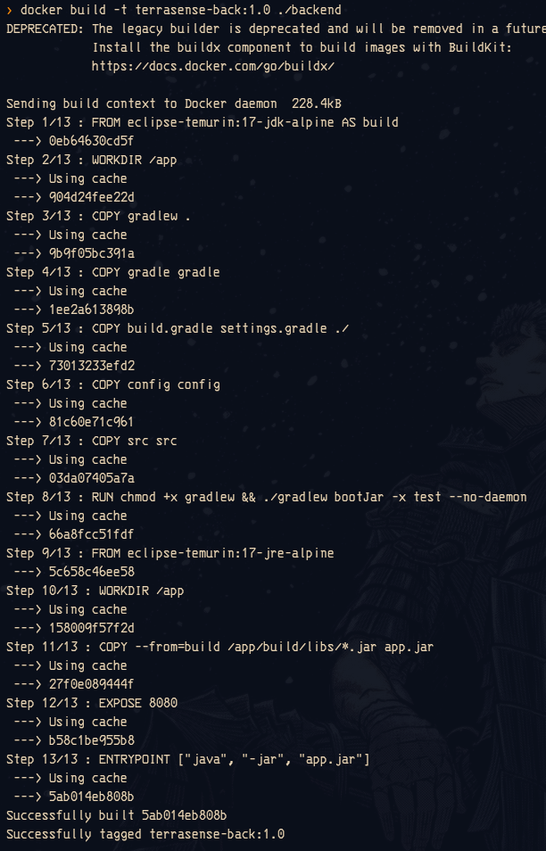

#### 2. Construcción de la imagen del Frontend

```bash
docker build -t terrasense-front:1.0 ./frontend
```

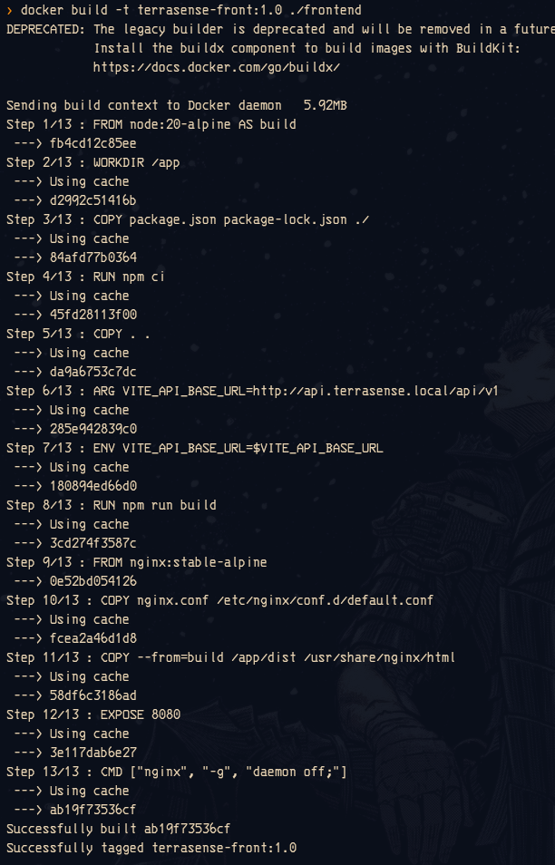

#### 3. Verificación del tamaño de las imágenes generadas

```bash
docker images | grep terrasense
```

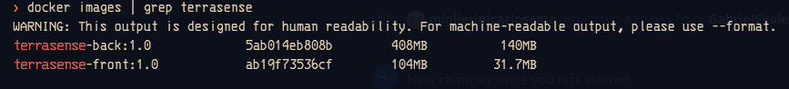

---

### 3.2 Instrucciones y Despliegue del Clúster en Minikube

Para levantar toda la arquitectura desde cero en un entorno limpio:

```bash
# 1. Iniciar el clúster y habilitar addons de Ingress y Metrics Server
minikube start --driver=docker
minikube addons enable ingress
minikube addons enable metrics-server

# 2. Cargar las imágenes locales en el nodo de Minikube
minikube image load terrasense-back:1.0
minikube image load terrasense-front:1.0

# 3. Aplicar los manifiestos declarativos (Namespace, ConfigMap, Secret, DB, Back, Front, Ingress y HPA)
kubectl apply -f TPs/TP4-HPA-y-K6/k8s/

# 4. Asociar los dominios locales a la IP de Minikube
echo "$(minikube ip) terrasense.local api.terrasense.local" | sudo tee -a /etc/hosts
```

#### Paso 1: Creación e inicio del clúster (`minikube start --driver=docker`)

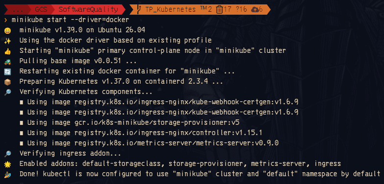

#### Paso 2: Habilitación de `ingress` y `metrics-server`

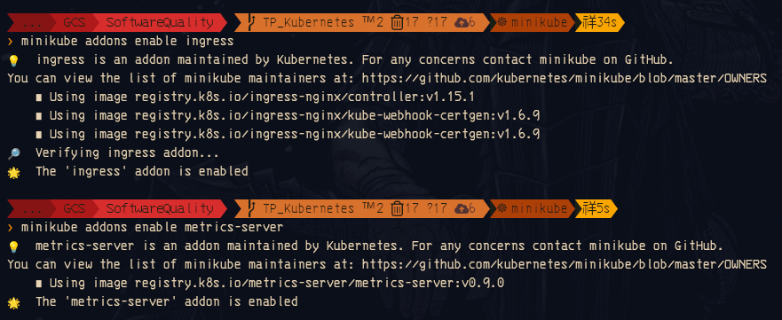

#### Paso 3: Aplicación de los manifiestos de Kubernetes ([`TPs/TP4-HPA-y-K6/k8s/`](./k8s/))

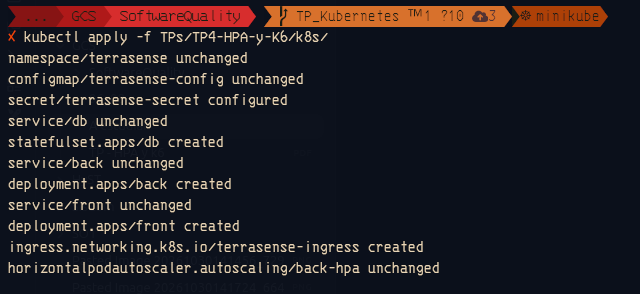

#### Paso 4: Verificación inicial del clúster (`kubectl get pods,svc,ingress,hpa -n terrasense`)

En la primera revisión observamos que `db-0` y `front` estaban `1/1 Running`, pero el Pod `back` figuraba como `0/1 Running` con `3 RESTARTS`:

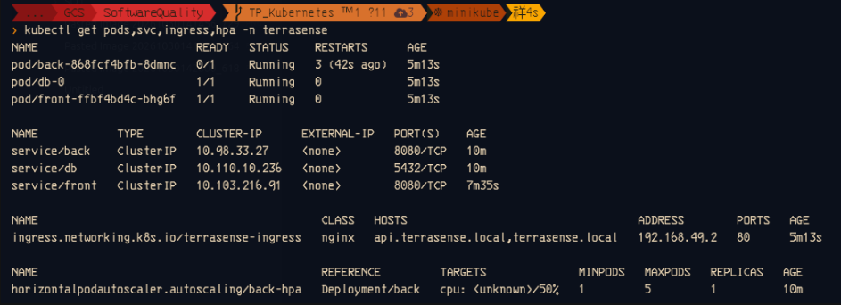

#### Paso 5: Diagnóstico del reinicio en los logs del Backend (`kubectl logs --previous`)

Al inspeccionar los logs vimos que con un límite de `300m` de CPU, Spring Boot tardaba **52.8 segundos** en iniciar (`initialization completed in 52806 ms`), superando los `40s` del `initialDelaySeconds` de la `livenessProbe` y haciendo que Kubernetes matara el contenedor antes de terminar de arrancar:

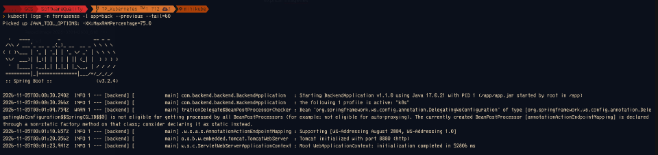

#### Paso 6: Clúster estabilizado y operativo

Tras ajustar `limits.cpu: 500m` e `initialDelaySeconds: 90` en [`04-backend.yaml`](./k8s/04-backend.yaml), todos los Pods (`back`, `db-0`, `front`), Services, Ingress y HPA quedaron `1/1 Running` con `0 RESTARTS`:

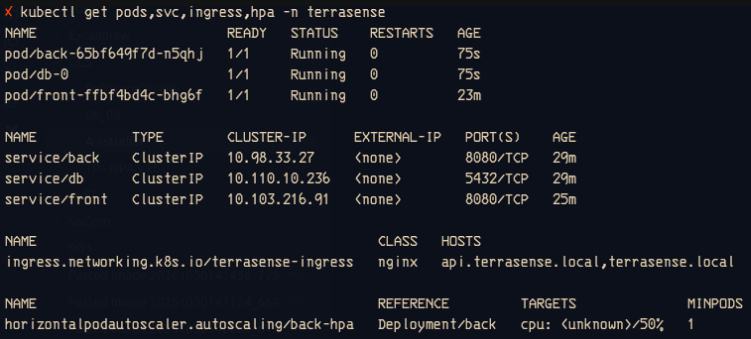

---

## 4. Pruebas de Carga con Grafana k6 (Actividad 3)

En todos los scripts de carga se evaluaron dos **SLOs (Objetivos de Nivel de Servicio)**:
- **Latencia de escritura**: `p(95) < 300ms` (`http_req_duration{type:write}`).
- **Tasa de fallos**: `< 1%` (`http_req_failed: ['rate<0.01']`).

---

### 4.1 Smoke Test ([`01-smoke-test.js`](./k6/01-smoke-test.js))

- **¿Qué hace la prueba?**: Verifica que el sistema funcione correctamente bajo una carga mínima de **2 usuarios virtuales (VUs) durante 20 segundos**. Cada VU inserta un producto nuevo (`POST /api/v1/producto/new`) y luego consulta el catálogo (`GET /api/v1/producto/getProductosPorFiltro`).

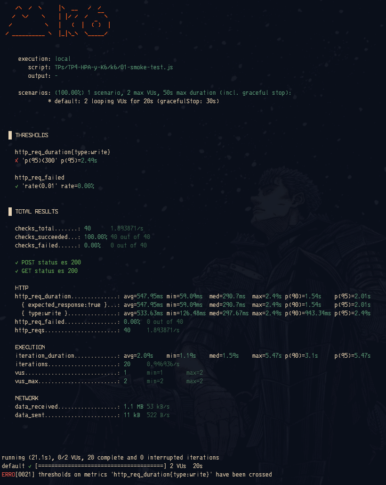

- **¿Qué se ve en los resultados?**:
  - **Disponibilidad del 100%**: Los **`40` checks (`40 de 40`)** fueron exitosos (`0.00%` de fallos), cumpliendo el SLO `rate<0.01`.
  - **Latencia**: La mediana fue de **`290.7 ms`**, pero el percentil 95 alcanzó **`2.01 s`** (`2.49 s` en escrituras), superando los `300 ms` debido al arranque en frío de la JVM y a la lectura de `1.1 MB` de productos acumulados en el volumen persistente de PostgreSQL.

Al consultar el estado del clúster (`kubectl get pods,svc,ingress,hpa -n terrasense`), vemos cómo el HPA gestiona las réplicas activas del Backend (`Deployment/back`) distribuyendo la carga de CPU (`cpu: 15%/50%`):

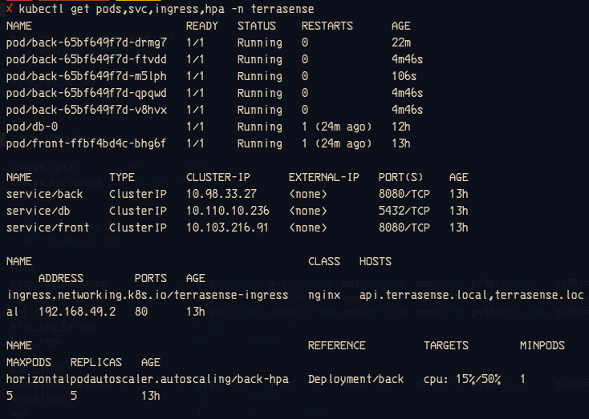

---

### 4.2 Load Test ([`02-load-test.js`](./k6/02-load-test.js)) y Reacción del HPA

- **¿Qué hace la prueba?**: Simula un pico comercial subiendo progresivamente de **0 a 2.000 VUs en 1 minuto**, sosteniendo **2.000 VUs concurrentes durante 1 minuto** enviando peticiones `POST /api/v1/producto/new` y bajando a 0 en 30 segundos.

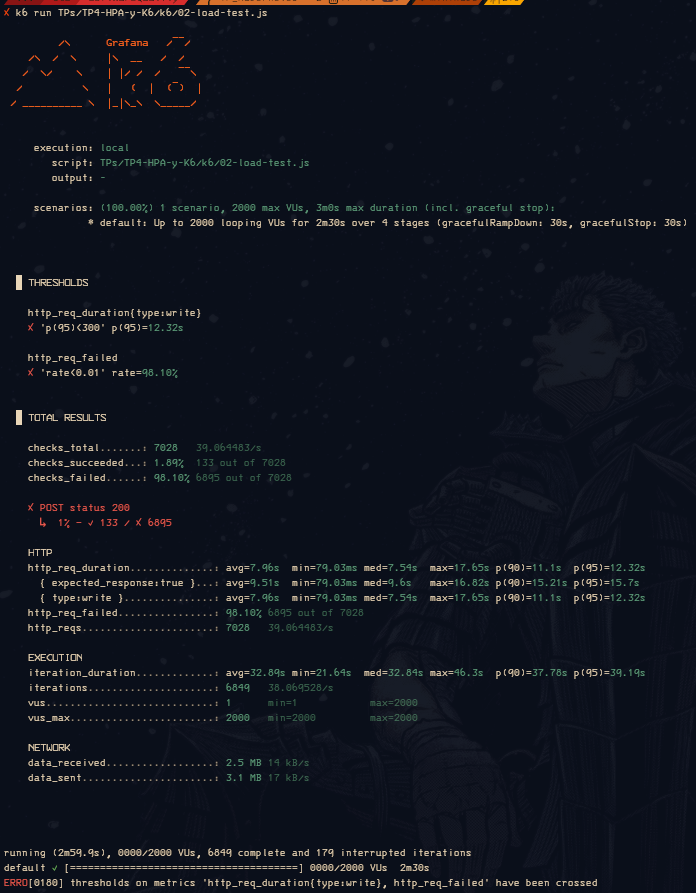

- **¿Qué se ve en los resultados de `k6`?**:
  - Se ejecutaron **`7.028` peticiones** (`39.06 req/s`). Con 2.000 usuarios concurrentes escribiendo en la base de datos, el sistema superó su capacidad máxima: solo **`133` peticiones (`1.89%`)** respondieron `200 OK` y el **`98.10%` (`6.895`)** falló, elevando la latencia `p(95)` a **`12.32 s`** (mediana `7.54 s`).

- **¿Qué se ve en el monitoreo del HPA (`kubectl get hpa -n terrasense -w`)?**:
  - El consumo de CPU salta de `8%` a **`380%/50%`** y luego al tope de **`500%/50%`**, disparando el autoescalado automático de **1 -> 4 -> 5 réplicas** (`MAXPODS`). Finalizada la prueba, la CPU vuelve a bajar a `185% -> 25% -> 13%`. La saturación ocurre porque 5 Pods y una instancia de PostgreSQL sin *pool* de conexiones (`max_connections = 100`) no alcanzan para sostener 2.000 escrituras simultáneas.


---

### 4.3 Stress Test ([`03-stress-test.js`](./k6/03-stress-test.js))

- **¿Qué hace la prueba?**: Busca el punto de quiebre (*breaking point*) de la API sometiendo al sistema a escalones crecientes de **200, 500, 800 y 1.000 VUs** con esperas mínimas (`0.2s` entre iteraciones) y un *timeout* estricto de `5s`.

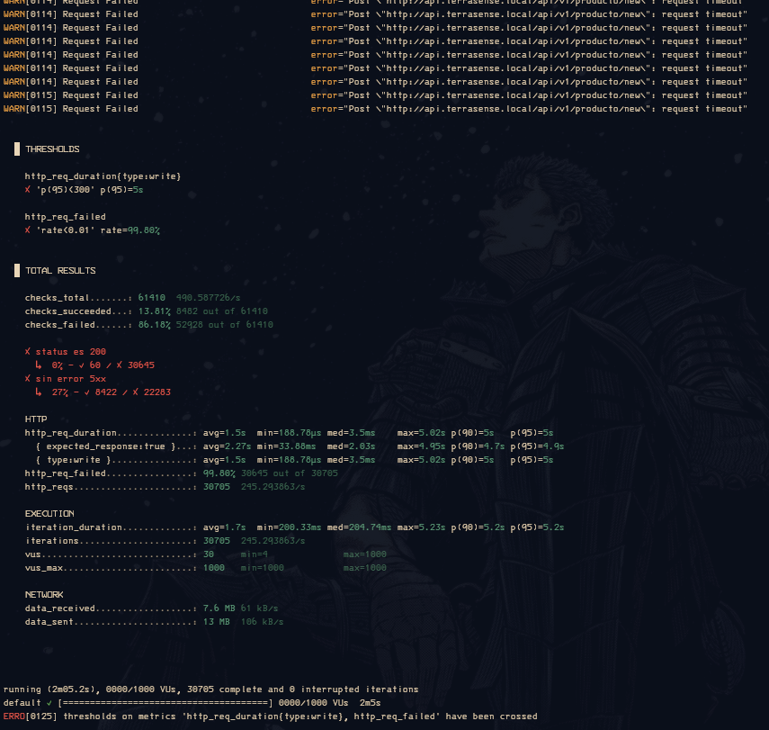

- **¿Qué se ve en los resultados?**:
  - Se lanzaron **`30.705` peticiones HTTP** (`245.29 req/s`) y **`61.410` validaciones (checks)**.
  - El **`99.80%` de las peticiones (`30.645 de 30.705`)** falló por `request timeout` al cumplirse los **`5 s`** (`p(95) = 5s`), logrando solo **`60` inserciones exitosas (`status 200`)** en los primeros segundos de la prueba.
  - Esto confirma que para operaciones de escritura directa en base de datos sin *connection pooling*, el punto de quiebre se alcanza ya en el primer escalón de **200 VUs concurrentes**.

---

## 5. Pruebas de Fallas y Análisis de Resiliencia (Actividad 4)

### 5.1 Experimento 1: Caída de Pod en Vivo y Experiencia de Usuario ([`04-e1-ux-failover.js`](./k6/04-e1-ux-failover.js))

- **¿Qué hace la prueba?**: Combina dos escenarios en paralelo dentro de un mismo script:
  1. `carga_estable_api`: **10 VUs** realizan consultas constantes (`GET /getProductosPorFiltro`) a la API durante 40 segundos.
  2. `navegador_ux`: En el segundo 8 —justo cuando eliminamos un Pod del Backend en vivo con `kubectl delete pod`— `k6/browser` abre una instancia real de **Chromium** en `http://terrasense.local/`, mide los *Core Web Vitals* y guarda una captura de pantalla ([`falla-ux.png`](./evidence/falla-ux.png)).

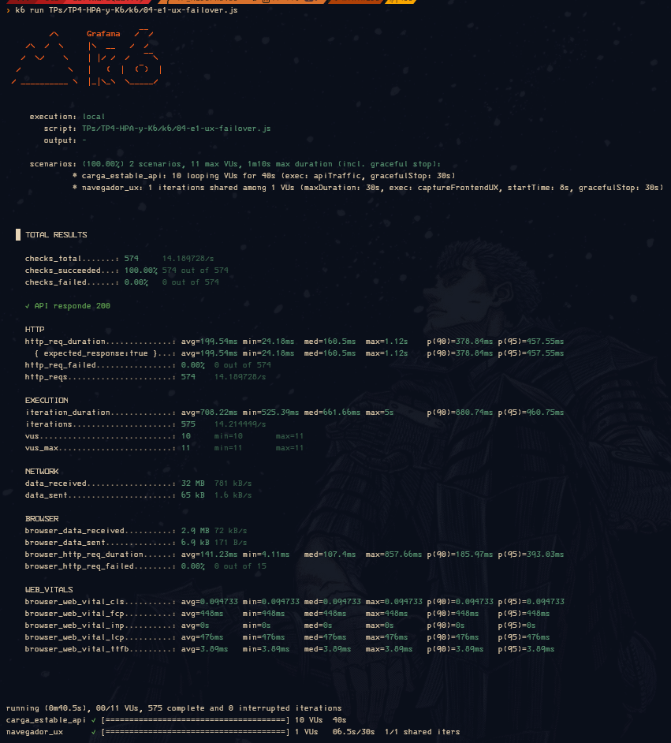

- **¿Qué se ve en los resultados de `k6`?**:
  - **Tolerancia a fallos del 100% (`0.00%` de errores)**: Las **`574` peticiones a la API** (`574 de 574`) y las **`15` peticiones HTTP del navegador** fueron exitosas, transfiriendo `32 MB` de datos con un tiempo de respuesta mediano de **`160.5 ms`** y un **`p(95) = 457.55 ms`**.
  - **Experiencia de usuario intacta (`WEB_VITALS`)**: El navegador cargó la tienda con métricas óptimas: **TTFB = `3.89 ms`**, **FCP = `448 ms`**, **LCP = `476 ms`** y **CLS = `0.0947`**.

#### Captura de Pantalla Obtenida por `k6/browser` (`falla-ux.png`)


- **¿Qué se ve en la captura de interfaz?**:
  - Al contar con múltiples réplicas activas en el `Deployment/back`, cuando un Pod es eliminado el `Service` de Kubernetes lo retira instantáneamente del balanceo y redirige las conexiones a los Pods sanos. El usuario final visualiza la tienda y las tarjetas de productos sin pantallas de error. *(En cambio, si el clúster está en reposo con `1` sola réplica `MINPODS=1` y ese único Pod cae, el tráfico sufre timeouts hasta que el nuevo contenedor termina su arranque).*

---

### 5.2 Experimento 2: Spike Test de Tráfico Masivo ([`05-e2-spike-test.js`](./k6/05-e2-spike-test.js))

- **¿Qué hace la prueba?**: Simula una avalancha súbita de tráfico pasando de **0 a 1.500 VUs en apenas 5 segundos** y sosteniendo el ataque durante 40 segundos, ejecutando en simultáneo escrituras (`POST /new`) y lecturas (`GET /list`) sin tiempo de espera (`sleep(0.1)`).

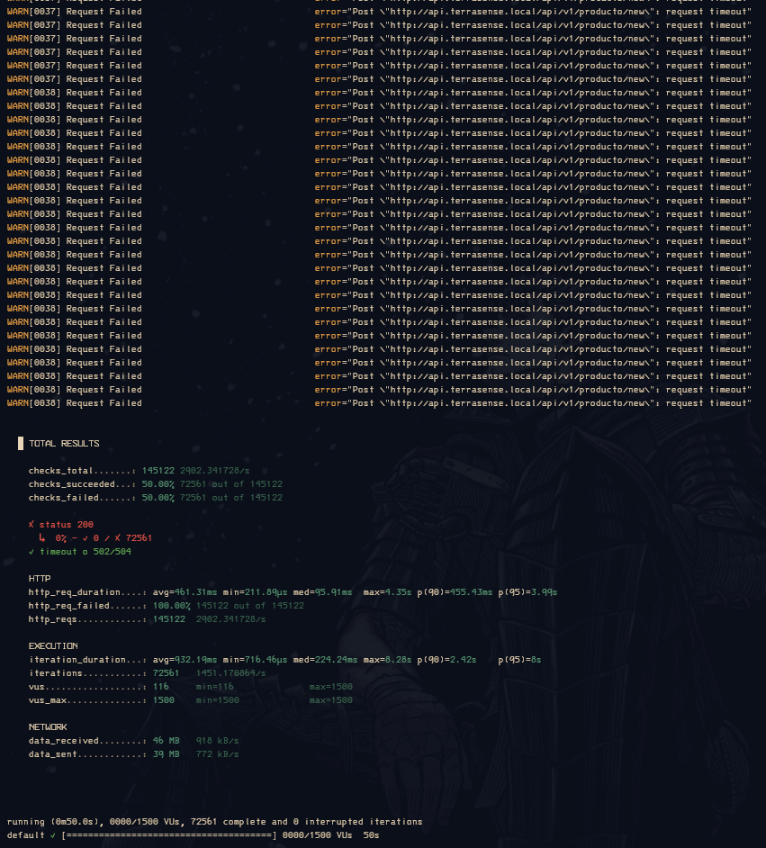

- **¿Qué se ve en los resultados?**:
  - `k6` generó **`145.122` peticiones HTTP** a una velocidad extrema de **`2.902,34 req/s`** (`72.561` iteraciones).
  - **Colapso total por inercia (`100.00%` de fallos)**: Las **`145.122` peticiones** fallaron por `request timeout` o error `502/504` (`0` respuestas `200 OK`), con un `p(95) = 3.99 s`.
  - **Efecto dominó en los Pods**: La CPU de los 5 Pods saltó a **`456%/50%`**. Al quedar el procesador completamente estrangulado (*CPU throttling*), los contenedores de Spring Boot no pudieron responder a tiempo la sonda `livenessProbe` (`/actuator/health/liveness`). Kubernetes interpretó que las 5 instancias estaban colgadas y las mató con `Exit Code: 143` (`SIGTERM`), reiniciando los 5 Pods simultáneamente.

---

## 6. Aprendizaje: Complicaciones Encontradas y Cómo las Solucionamos

1. **Permisos sobre `/var/run/docker.sock` sin usar `sudo`**:
   - *Problema*: Minikube con `--driver=docker` prohíbe ejecutarse con `sudo`, pero nuestro usuario no tenía permisos sobre el socket de Docker (y cada vez que se reinicia la PC, el socket se recrea).
   - *Solución*: En lugar de agregar el usuario al grupo `docker` de forma permanente (riesgo de seguridad equivalente a `root`), aplicamos `sudo setfacl -m u:$USER:rw /var/run/docker.sock` para habilitar el acceso temporalmente durante la sesión.

2. **Reemplazo de Firebase por PostgreSQL y acumulación de datos en el `PVC`**:
   - *Problema*: El backend original leía credenciales de Firebase desde un archivo `.env` local. Además, al usar un `StatefulSet` con disco persistente (`PVC`) para PostgreSQL, los miles de productos insertados durante los *Load/Stress Tests* quedaban guardados en la tabla `productos`, haciendo que las pruebas siguientes tuvieran que descargar respuestas JSON cada vez más pesadas (`5 MB` a `32 MB`).
   - *Solución*: Implementamos `@Profile("k8s")` con PostgreSQL + `.ignoreIfMissing()` en `Dotenv`, y aprendimos cómo limpiar los registros acumulados en `db-0` mediante `kubectl exec` cuando necesitamos reiniciar el estado de las pruebas.

3. **Permisos en Gradle, errores de compilación en cascada con Lombok y Checkstyle**:
   - *Problema*: Al compilar el backend surgieron errores de permisos (`./gradlew: Permission denied`), un typo en `PostgresCategoriaReposiroty.java`, un typo en `DataSourceAutoConfigurarion` y 96 errores de compilación porque faltaba el `import org.springframework.context.annotation.Profile;` (lo que frenaba a Lombok antes de generar los *getters/setters*).
   - *Solución*: Dimos permisos con `chmod +x backend/gradlew`, corregimos los nombres y ordenamos alfabéticamente los *imports* según las reglas de `checkstyle.xml`, pasando los 62 tests unitarios y el linter sin advertencias.

4. **Reinicio en bucle del Pod Backend (`0/1 Running`, `3 RESTARTS`) e indentación YAML**:
   - *Problema*: Al desplegar el clúster ([`image-6.png`](./evidence/image-6.png)), el Pod `back` se reiniciaba constantemente y `db-0` fallaba por errores de sangría al pegar los manifiestos YAML.
   - *Solución*: Revisando los logs con `kubectl logs --previous` ([`image-7.png`](./evidence/image-7.png)) vimos que con `limits.cpu: 300m` Spring Boot tardaba `52.8s` en arrancar, mientras que la `livenessProbe` empezaba a matar el Pod a los `40s`. Corregimos la indentación YAML, subimos el límite de CPU a `500m` y el `initialDelaySeconds` a `90s`, logrando que todos los Pods quedaran `1/1 Running` ([`image-8.png`](./evidence/image-8.png)).
