Preparacion para implementacion de kubernetes.

Herramientas necesarias:

    dependencias de la aplicacion:
        El proyecto base utiliza un backend de java, por lo que es necesario instalar Java JDK 17:
            sudo apt update && apt install -y openjdk-17-jdk
            sudo update-alternatives --config java
        podemos verificar la instalacion con:
            java -version
        
        Para el frontend es necesario contar con Node.js y npm, esto se puede instalar de la siguiente manera:
            curl -o- https://raw.githubusercontent.com/nvm-sh/nvm/v0.40.1/install.sh | bash
            source ~/.bashrc
            nvm install 20
            nvm use 20
        podemos verificar la instalacion con:
            node --version
            npm --version
    
    Contenedores y Kubernetes
        El cluster de Kubernetes sera levantado por minikube utilizando Docker. Este ultimo se instala por medio de:
            sudo apt install -y docker.io
            sudo systemctl enable --now docker
        Minikube necesita acceso al docker.sock para crear el dontenedor del cluster pero no puede ser ejecutado por medio de sudo, por lo que necesita que el usuario que lo esta ejecutando sea agregado al grupo docker. Podemos hacer que esta asignacion sea temporal hasta terminar la sesion actual por medio del siguiente comando:
            sudo setfacl -m u:$USER:rw /var/run/docker.sock
        podemos verificar el funcionamiento de docker por medio de:
            docker ps
        Para gestionar el cluster debemos instalar kubectl:
            curl -LO "https://dl.k8s.io/release/$(curl -L -s https://dl.k8s.io/release/stable.txt)/bin/linux/amd64/kubectl"

            sudo install -o root -g root -m 0755 kubectl /usr/local/bin/kubectl
            
            rm kubectl

            kubectl version --client
        La creacion del Cluster de kubernetes se realiza por medio del minikube en un nodo local dentro de la PC. Por lo que necesitamos realizar la siguiente instalacion:
            curl -LO https://storage.googleapis.com/minikube/releases/latest/minikube-linux-amd64

            sudo install minikube-linux-amd64 /usr/local/bin/minikube
            
            rm minikube-linux-amd64

            minikube version

    K6:
        K6 se encargara de la ejecucion de scripts para simular el acceso concurrente de usuarios y medir latencia y tasa de fallos.
            K6_VERSION=$(curl -s https://api.github.com/repos/grafana/k6/releases/latest | grep '"tag_name":' | sed -E 's/.*"([^"]+)".*/\1/')
            
            curl -LO "https://github.com/grafana/k6/releases/download/${K6_VERSION}/k6-${K6_VERSION}-linux-amd64.tar.gz"

            tar -xzf "k6-${K6_VERSION}-linux-amd64.tar.gz"

            sudo install "k6-${K6_VERSION}-linux-amd64/k6" /usr/local/bin/k6

            rm -rf "k6-${K6_VERSION}-linux-amd64" "k6-${K6_VERSION}-linux-amd64.tar.gz"

            k6 version
        
        Esta herramienta cuenta con un modulo de browser por el cual podemos realizar pruebas de navegacion. Este utiliza el protocolo de navegacion Chrome, por lo que es necesario contar con un navegador basado en chromium para realizar estas pruebas. En este caso se utiliza el chromium:
            sudo apt install -y chromium-browser

Hasta ahora el proyecto utiliza google cloud por medio de firebase para realizar las peticiones por medio de la api, pero esto puede limitar la cantidad de peticiones simultaneas realizadas en prueba con kubernetes. Es por esto que se debe implementar soporte de PostgreSQL, siendo este ejecutable dentro de un contenedor de nuestro cluster de kubernetes. Esto nos permite clonar y levantar el proyecto en un miniokube desde cero. Esto tambien nos permite implementar el despliegue autonomo de la base de datos por medio de un .yaml como el siguiente:

Adaptacion del Backend

Para no crear cambios significativos que puedan llevar a conflictos con lo desarrollado previamente para el proyecto, se aplicara el uso de PostgreSQL solo para el testeo por m edio de kubernetes, Esto lo podemos realizar generando perfiles de Spring para diferentes casos de uso.

Entre los cambios del backend tenemos:
    Agregado de dependencias de PostgreSQL, Actuator y JDBC en build.generate. Actuator nos dara los endpoints de monitoreo que consultara kubernetes (liveness y readyness) para conocer el estado del Pod. 

    Configuracion de aplication.properties para establecer la conexion a la base de datos correspondiente en el caso realizar tests con kubernetes

    BackendAplication.java: utiliza Dotenv buscando las credenciales dentro del .env, se necesita cambiar este comportamiento para que las variables de entorno sean inyectadas por kubernetes directamente.

    Se inserta configuracion para funcionar con mas de un perfil, donde se cambia el acceso a funciones de "repositories" dependiendo del perfil utilizado. Esto se realiza por medio de @Profile(), anotacion que indica bajo que perfil se debe o no usar una clase. Aparte de definir los perfiles, se generan nuevas clases que realizan el control de la base de datos PostgreSQL.

Lift and Shift
    Empaquetado de API y Frontend en imagenes Docker eficientes para desplegar en el cluster.

        Dockerignore: ignora los datos especificados a la hora de generar la docker image.

        Dockerfile: esta compuesto con las instrucciones necesarias para generar la docker image de nuestro proyecto.
    
        nginx.conf: configura el servidor web NGINX en base a la configuracion del resto de nuestro proyecto.

        Creacion de docker images:
            docker build -t terrasense-back:1.0 ./backend
           
            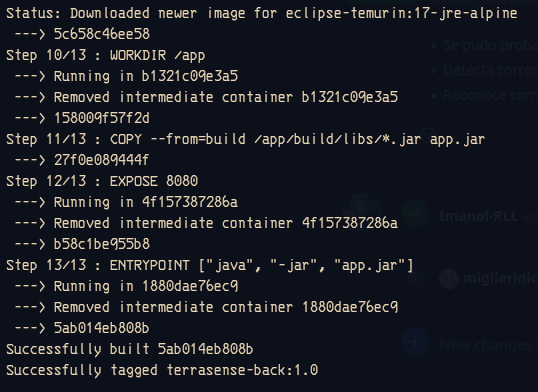

            docker build -t terrasense-front:1.0 ./frontend

            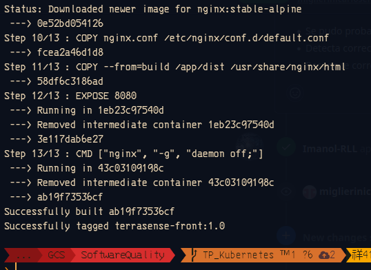

            

Con las imagenes generadas podemos proceder al despliegue del cluster por medio de Minikube:
    .
    .
    .
    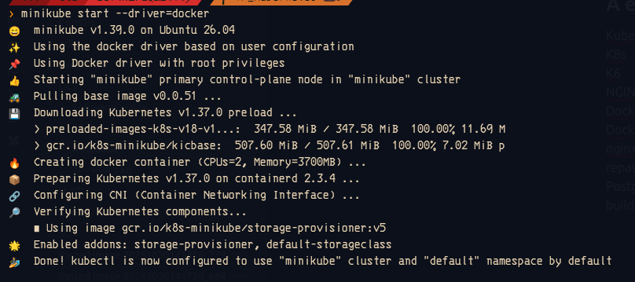

    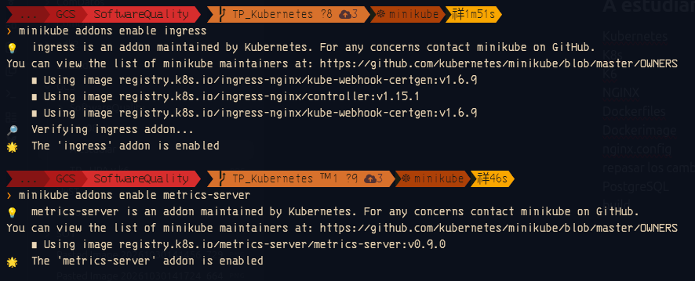

    

    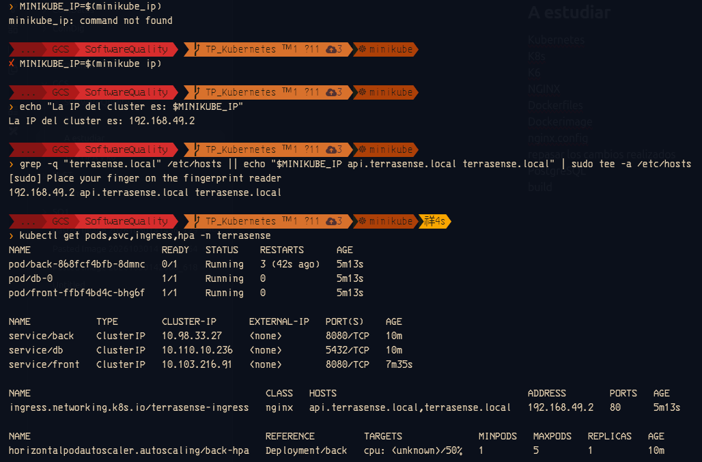

    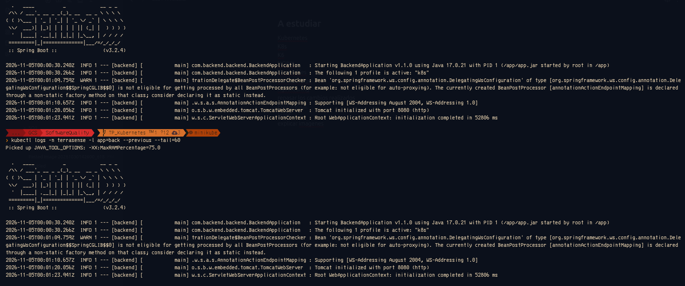

    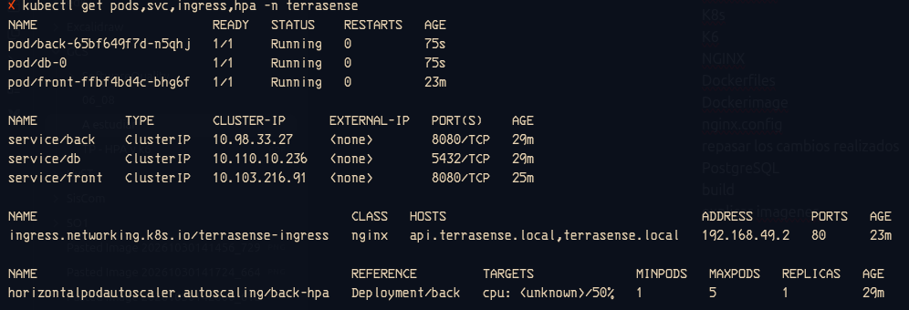

Pruebas de carga con k6
    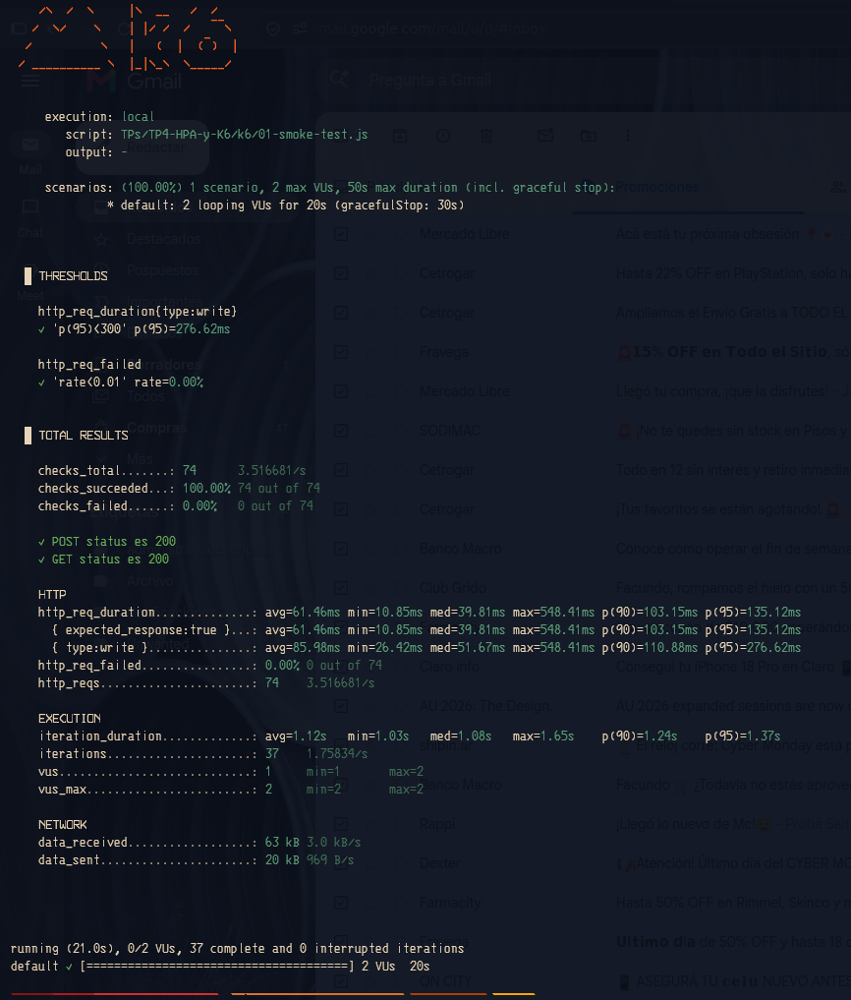

    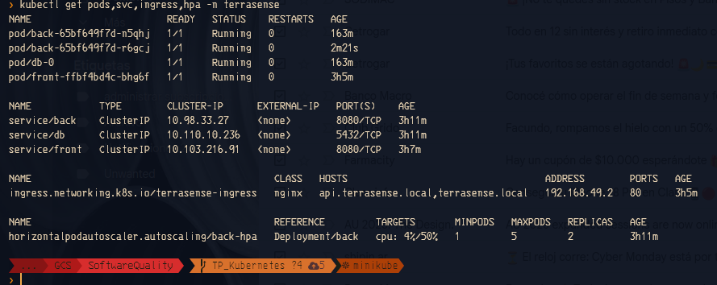
    
    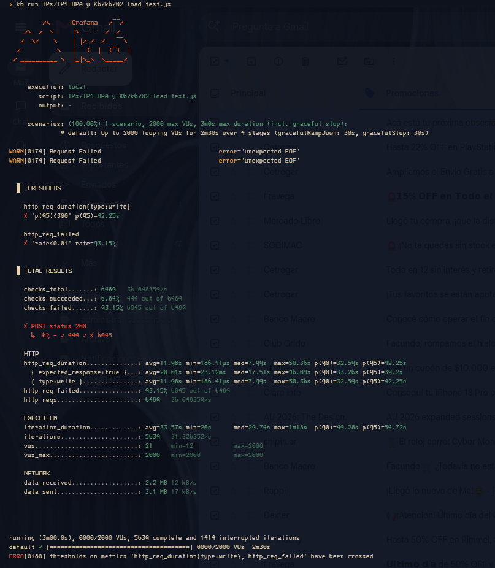

    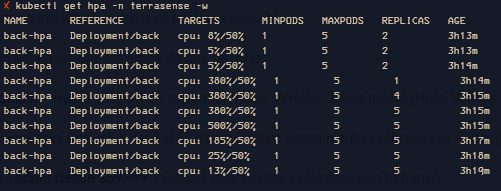

    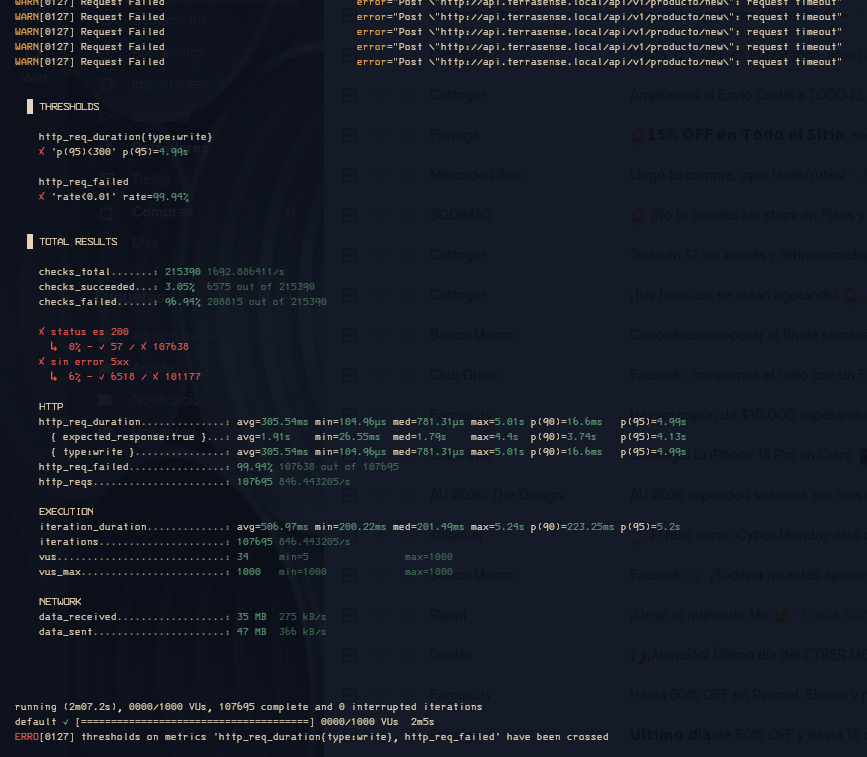

Pruebas de fallas
    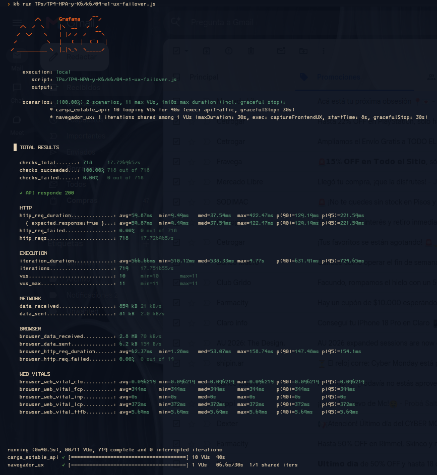

    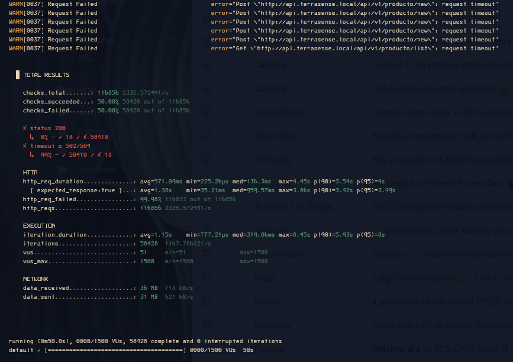

    